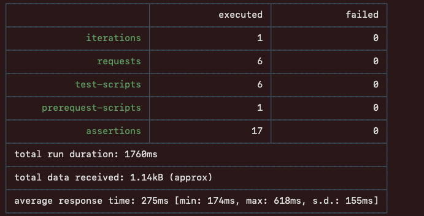

# gorest-api-automation-postman-newman
## Environment Setup

The real environment file (`environments/GoRestEnv.json`) is **not** committed because it contains an API token. To run the collections:

1. Get a free access token from https://gorest.co.in/consumer/login
2. Copy the template:
   ```bash
   cp environments/GoRestEnv.example.json environments/GoRestEnv.postman_environment.json
   ```
3. Open the copied file and set your values:

| Variable  | Description                  | Example               |
|-----------|------------------------------|-----------------------|
| `baseURL` | GoRest API base URL          | `https://gorest.co.in`|
| `token`   | Your GoRest access token     | `<your-token>`        |

The copied file is gitignored, so your token stays local.

## Running

```bash
newman run collections/GoRest-Workflow-v3.json \
  -e environments/GoRestEnv.json
```

## 1. Run Locally with Newman

[Newman](https://github.com/postmanlabs/newman) is Postman's command-line runner. It executes a collection outside the Postman app and returns exit code `0` if all tests pass and `1` if any fail, which is how CI tools such as Jenkins detect failures.

### Prerequisites
- Node.js 18 or later
- A copy of `environments/GoRestEnv.example.json` saved as `environments/GoRestEnv.json`, with your GoRest token filled in (see [Environment Setup](#environment-setup))

### Install and verify
```bash
npm install -g newman
newman --version
```

### Run the workflow collection
```bash
newman run collections/GoRestAPI-Workflow-v3.json \
  -e environments/GoRestEnv.json
```

### Run the data-driven collection
```bash
newman run collections/DataDrivenAPIsCollection.json \
  -e environments/GoRestEnv.json \
  -d data/myuser.csv
```
Each row in the CSV runs the collection once, so a 3-row file gives 3 iterations.

### Verify the result
- The CLI summary shows all requests and assertions with `0` failed.
- Check the exit code (`echo $?` on macOS/Linux, `echo %ERRORLEVEL%` on Windows):
  - `0`: all tests passed
  - `1`: at least one test failed

