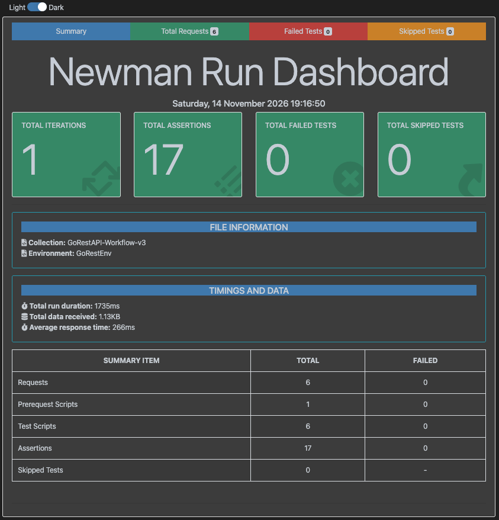

# gorest-api-automation-postman-newman
## Environment Setup

The real environment file (`environments/GoRestEnv.json`) is **not** committed because it contains an API token. To run the collections:

1. Get a free access token from https://gorest.co.in/consumer/login
2. Copy the template:
   ```bash
   cp environments/GoRestEnv.example.json environments/GoRestEnv.postman_environment.json
   ```
3. Open the copied file and set your values:

| Variable  | Description                  | Example               |
|-----------|------------------------------|-----------------------|
| `baseURL` | GoRest API base URL          | `https://gorest.co.in`|
| `token`   | Your GoRest access token     | `<your-token>`        |

The copied file is gitignored, so your token stays local.

## Running

```bash
newman run collections/GoRest-Workflow-v3.json \
  -e environments/GoRestEnv.json
```

## 1. Run Locally with Newman

[Newman](https://github.com/postmanlabs/newman) is Postman's command-line runner. It executes a collection outside the Postman app and returns exit code `0` if all tests pass and `1` if any fail, which is how CI tools such as Jenkins detect failures.

### Prerequisites
- Node.js 18 or later
- A copy of `environments/GoRestEnv.example.json` saved as `environments/GoRestEnv.json`, with your GoRest token filled in (see [Environment Setup](#environment-setup))

### Install and verify
```bash
npm install -g newman
newman --version
```

### Run the workflow collection
```bash
newman run collections/GoRestAPI-Workflow-v3.json \
  -e environments/GoRestEnv.json
```

### Run the data-driven collection
```bash
newman run collections/DataDrivenAPIsCollection.json \
  -e environments/GoRestEnv.json \
  -d data/myuser.csv
```
Each row in the CSV runs the collection once, so a 3-row file gives 3 iterations.

### Verify the result
- The CLI summary shows all requests and assertions with `0` failed.
- Check the exit code (`echo $?` on macOS/Linux, `echo %ERRORLEVEL%` on Windows):
  - `0`: all tests passed
  - `1`: at least one test failed


## 2. Run with Docker

Runs the same collections in a container, so you don't need Node.js or Newman installed. The image contains only Newman and the HTML reporter. The collections, environment file and CSV are mounted from your machine at run time, so the API token is never baked into the image.

### Prerequisites
- Docker installed and running
- `environments/GoRestEnv.json` created from the example file (see [Environment Setup](#environment-setup))

### Build the image (once)
```bash
docker build -t gorest-newman .
```

### Run the workflow collection
```bash
docker run --rm -v "$(pwd)":/app gorest-newman \
  run collections/GoRestAPI-Workflow-v3.json \
  -e environments/GoRestEnv.json \
  -r cli,htmlextra --reporter-htmlextra-export reports/workflow.html
```

### How it works
| Part | Purpose |
|------|---------|
| `-v "$(pwd)":/app` | Mounts the repo into the container's working directory, so the collection, environment and CSV are read from the host and reports are written back to `reports/` |
| `gorest-newman` | The image built above; its entrypoint is `newman`, so everything after the image name is passed to Newman |
| `-r cli,htmlextra` | Prints results in the terminal and generates an HTML report |
| `--rm` | Removes the container after the run |

On Windows PowerShell, use `${PWD}` instead of `$(pwd)`.

### Results
Open `reports/workflow.html` or `reports/datadriven.html` in a browser. The container's exit code is `0` when all tests pass and `1` when any fail, which is what Jenkins uses to mark the build.



## 3. Run with Jenkins

Jenkins checks the repo out of GitHub, runs the Newman command in a shell step, and uses Newman's exit code (`0` = all tests passed, `1` = a test failed) to mark the build green or red. The API token comes from a Jenkins credential, so it is never stored in the repo.

Install and configure Jenkins first: **[docs/jenkins-setup.md](docs/jenkins-setup.md)**

### Store the API token as a credential

1. **Manage Jenkins → Credentials → System → Global credentials (unrestricted) → Add Credentials**
2. Fill in:
   - **Kind:** Secret text
   - **Secret:** your GoRest access token
   - **ID:** `gorest-token`
   - **Description:** GoRest API token
3. Click **Create**.

### Create the freestyle job

1. **Dashboard → New Item**. Enter the name `gorest-workflow-newman`, choose **Freestyle project**, and click **OK**.

2. **Source Code Management → Git**
   - **Repository URL:** `https://github.com/<your-username>/<your-repo>.git`
   - **Branch Specifier:** `*/main`
   - A public repo needs no credentials.

3. **Build Environment**
   - Tick **Use secret text(s) or file(s)**.
   - **Add → Secret text**, set **Variable** to `GOREST_TOKEN`, and select the `gorest-token` credential.

4. **Build Steps → Add build step → Execute shell**
   ```bash
   newman run collections/GoRestAPI-Workflow-v3.json \
     -e environments/GoRestEnv.example.json \
     --env-var "token=$GOREST_TOKEN" \
     -r cli,htmlextra --reporter-htmlextra-export reports/workflow.html
   ```
   Why the example environment file: the real `GoRestEnv.json` is gitignored, so it does not exist in the checkout. The example file contains `baseURL`, and `--env-var` supplies the token. The variable name (`token`) must match the name your collection uses.

5. **Post-build Actions → Publish HTML reports → Add**
   - **HTML directory to archive:** `reports`
   - **Index page[s]:** `workflow.html`
   - **Report title:** Newman Report

6. Click **Save**.

To create the data-driven job, clone the job (**New Item → Copy from**), change the collection path in the shell step to the data-driven collection, and add `-d data/myuser.csv` and a different report file name (e.g. `reports/datadriven.html`).

### Run and verify

1. Open the job and click **Build Now**.
2. Click the build number (e.g. `#1`) and then **Console Output**. You should see the Newman summary with all assertions passed and `Finished: SUCCESS`.
3. On the job page, click the **Newman Report** link to open the HTML report.
4. **Check that failures are detected:** change one assertion in the collection so that it fails, push the change, and build again. The build should turn red, with `Finished: FAILURE`. Then revert the change.

### Troubleshooting

| Symptom | Cause and fix |
|---------|---------------|
| `newman: command not found` | Jenkins was started from a terminal without Newman on its `PATH`. Restart Jenkins from a terminal where `newman --version` works. |
| `401` or empty token errors from the API | The credential is not bound or its ID is wrong. Check the variable name in the build environment and the `--env-var` key. |
| Environment file not found | The job points at `GoRestEnv.json`, which is gitignored. Use `GoRestEnv.example.json`. |
| HTML report is blank or has no styling | Jenkins' Content Security Policy blocks the report's inline scripts. Open the generated file from the workspace or download it. |